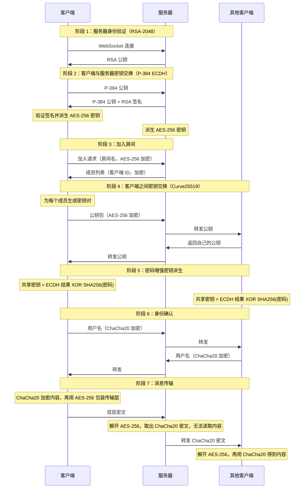

# ZQ-Chat

端到端加密的实时聊天系统。加密与解密全部在浏览器本地完成，服务器只转发密文，无法取得任何明文内容。

前端无框架依赖，后端运行在 Cloudflare Workers 与 Durable Objects 上，通过 WebSocket 通信。

## 部署

### 一键部署

[](https://deploy.workers.cloudflare.com/?url=https://github.com/BAYUEQI/ZQ-Chat)

该方式会基于本仓库创建一份新项目，后续本仓库的更新不会自动同步过去。

### 从 fork 部署

1. 将本项目 fork 到自己的 GitHub 账号。
2. 在 Cloudflare Workers 控制台选择「从 GitHub 导入」，选中 fork 后的仓库完成部署。

仓库内置了同步 workflow，fork 之后主仓库的更新会自动同步过来，Cloudflare 随之重新部署。

### 本地运行

```bash
npm install
npm run build
npx wrangler dev
```

`npx wrangler deploy` 发布到 Cloudflare。Worker 名称在 `wrangler.toml` 的 `name` 字段中设置，部署后可通过 `https://<name>.<子域>.workers.dev` 访问。

`wrangler.toml` 需要保留两项绑定：Durable Objects 的 `CHAT_ROOM`（对应 `ChatRoom` 类）与静态资源的 `ASSETS`（指向构建产物 `./dist`）。

## 使用

进入页面后填写用户名、房间名与房间密码。房间名相同即进入同一房间，密码必须一致才能互相解密。

房间内的在线成员列表对所有成员可见，成员加入或离开会实时提示。点击成员头像可发起私聊，内容只对该成员可见。新加入的成员看不到加入之前的消息。

支持发送图片与文件，也支持多选批量发送。界面提供主题背景与中英文切换。

## 加密设计

### 三层密钥

| 层次 | 算法 | 作用 |
| --- | --- | --- |
| 服务器身份 | RSA-2048（RSASSA-PKCS1-v1_5 + SHA-256） | 客户端验证服务器公钥，防止中间人。密钥对在服务器内存中生成，24 小时轮换，不落盘 |
| 客户端与服务器 | ECDH P-384 | 每个客户端与服务器各协商一条独立通道，派生 AES-256 密钥 |
| 客户端之间 | ECDH Curve25519 | 每对成员各自协商共享密钥，用于聊天内容 |

服务器通道使用 AES-256-CBC 加密，客户端之间的消息使用 ChaCha20 加密，每条消息带独立的 IV 与随机数。消息因此在链路上经过两层加密：内层 ChaCha20 只有通信双方能解开，外层 AES-256 只有对应客户端与服务器能解开。

### 房间密码

房间密码作为密钥派生因子参与客户端之间的密钥计算：

```
共享密钥 = ECDH_Curve25519(己方私钥, 对方公钥) XOR SHA256(房间密码)
```

密码不同的两个客户端算出的密钥不同，无法解密彼此的消息。服务器不参与该计算，也无法获知密码。

### 消息流



### 存储

系统不使用数据库，也不保留聊天记录。消息只在转发过程中存在于内存，连接断开即消失。

## 技术栈

- 前端：原生 ES 模块，无框架，Vite 构建
- 后端：Cloudflare Workers + Durable Objects，WebSocket
- 密码学：Web Crypto API、elliptic（Curve25519 与 P-384）、aes-js、js-chacha20、js-sha256

文件按固定大小的分卷传输，分卷的加解密在独立的 Worker 线程中完成，不占用页面主线程。

## 安全建议

- 房间密码直接决定客户端之间的加密强度，应使用足够长的随机密码。
- 密码一旦泄露，该房间内的通信内容都可能被解密。
- 使用较新版本的现代浏览器，以保证 Web Crypto 的实现与性能。

## 开源协议

ISC

## 免责声明

本项目仅供学习与技术研究使用，不得用于任何违法活动。使用者应遵守所在国家和地区的法律法规，作者不承担因使用本软件而产生的任何责任。
